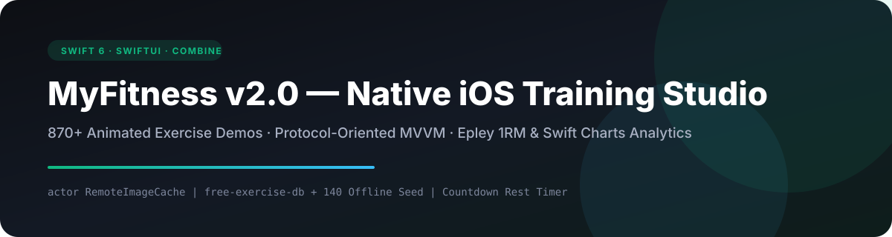
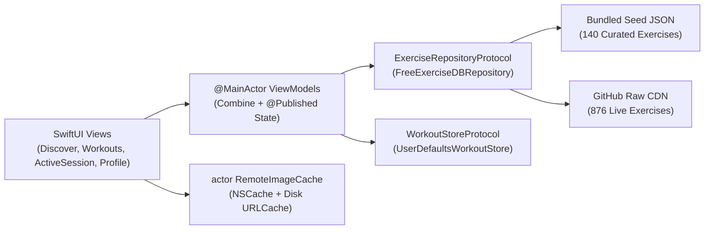

<div align="center">
  
</div>

<div align="center">

# 🏋️‍♂️ MyFitness v2.0 — Native iOS Training & Exercise Studio

**Swift 6 • SwiftUI • Combine • Protocol-Oriented MVVM • Swift Charts • 870+ Interactive Exercise Demos**

[](https://developer.apple.com/ios/)
[](https://swift.org)
[](https://github.com/Bugraciftci/MyFitness)
[-38BDF8?style=for-the-badge)](https://github.com/yuhonas/free-exercise-db)
[](./LICENSE)

</div>

---

## ✨ Overview

**MyFitness** is a modern, native iOS workout logger and interactive exercise encyclopedia built with **SwiftUI**, **Combine**, **Swift Charts**, and **Structured Concurrency (`async/await`, `actor`)**.

It integrates directly with the open-source [`yuhonas/free-exercise-db`](https://github.com/yuhonas/free-exercise-db) public-domain dataset (**870+ exercises**) while bundling a **140-exercise curated offline seed (`exercises_seed.json`)** for instant zero-latency startup and full offline resilience.

---

## 🚀 Key Engineering & Product Features

- **🎬 Interactive 2-Phase Exercise Motion Player (`ExerciseMotionPlayerView`):**
  - Smoothly animates between the starting position (`0.jpg`) and peak contraction (`1.jpg`) for every exercise in the catalog.
  - Supports play/pause, manual phase scrubbing, and tactile haptic feedback.
- **⚡ Hybrid Offline-First + Live Async Repository (`FreeExerciseDBRepository`):**
  - Boots instantaneously from the bundled 140-exercise JSON seed across all 14 muscle groups.
  - Synchronizes the full 870+ exercise catalog asynchronously over `URLSession` with `Result` error boundaries.
- **🧵 Actor-Isolated Image Caching (`RemoteImageCache`):**
  - Deduplicates in-flight image downloads using a Swift `actor`, backed by a 64 MB `NSCache` memory layer and a 150 MB disk `URLCache`.
- **🔍 Reactive Combine Filtering Pipeline (`DiscoverViewModel`):**
  - Debounced (`180ms`) multi-criteria filtering across search queries, 9 anatomical muscle groups, 6 equipment categories, and 3 difficulty levels.
- **📊 Live Workout Session Logger, Rest Timer & 1RM Analytics (`WorkoutViewModel`):**
  - Structured hypertrophy & strength splits (**Push / Pull / Legs**, **Upper / Lower Power**, **Athletic Full Body**) plus custom quick sessions.
  - Real-time set logging (`kg` / `lbs`), automatic countdown rest timer, **Epley 1RM estimation** ($1\text{RM} = w \times (1 + r/30)$), and **Swift Charts** 7-day volume & muscle distribution visualizations.

---

## 🏗️ Architecture & Project Structure

MyFitness follows a strict **Protocol-Oriented MVVM** architecture with constructor **Dependency Injection (`AppContainer`)** and value-type domain models:



```text
MyFitness/
├── MyFitnessApp.swift                      # Composition root & theme injection
├── Core/
│   ├── DI/
│   │   └── AppContainer.swift              # Dependency container for live & mock targets
│   ├── Models/
│   │   ├── Exercise.swift                  # Codable value types (Exercise, MuscleGroup, EquipmentFilter)
│   │   └── WorkoutModels.swift             # WorkoutPlan, LoggedSet (Epley 1RM), WorkoutSession, UserPreferences
│   ├── Networking/
│   │   ├── ExerciseRepository.swift        # Protocol + async/await live & offline seed repository
│   │   └── RemoteImageCache.swift          # Actor-isolated image loader with in-flight deduplication
│   └── Persistence/
│       └── WorkoutStore.swift              # Protocol + JSON persistence for sessions, favorites & settings
├── UI/
│   ├── Theme/
│   │   └── AppTheme.swift                  # Adaptive dark/light tokens, glass cards, HapticEngine
│   └── Components/
│       ├── ExerciseMotionPlayerView.swift  # 2-phase animated exercise form demonstration player
│       ├── ActivityRingView.swift          # Apple Fitness-style animated radial progress ring
│       ├── AsyncCachedImage.swift          # Lazy cached image view with crossfade transitions
│       └── MuscleBadgeView.swift           # Reusable anatomical badges & metric pills
├── Features/
│   ├── Root/
│   │   └── MainTabView.swift               # 4-tab HIG navigation & active workout sheet presentation
│   ├── Discover/
│   │   ├── DiscoverViewModel.swift         # Combine debounced search & multi-filter state machine
│   │   ├── DiscoverView.swift              # Readiness hero card, muscle carousel, filter bar & catalog
│   │   └── ExerciseDetailView.swift        # Animated motion player, muscles worked & numbered form cues
│   ├── Workouts/
│   │   ├── WorkoutViewModel.swift          # Active workout timer, rest timer, volume & 1RM calculations
│   │   ├── WorkoutsView.swift              # Swift Charts weekly load, structured programs & history
│   │   └── ActiveSessionView.swift         # Live set/rep/weight logger with keyboard toolbar & rest banner
│   ├── Favorites/
│   │   └── FavoritesView.swift             # Bookmarked exercise library
│   └── Profile/
│       ├── ProfileViewModel.swift          # Unit conversion (kg/lbs), goals, theme & muscle distribution
│       └── ProfileView.swift               # Swift Charts muscle breakdown & preferences
└── Resources/
    └── exercises_seed.json                 # 140 curated offline exercises with 2-phase image paths
```

---

## 🧪 Unit Testing (`MyFitnessTests`)

The project includes unit tests using mock protocols (`MockExerciseRepository`, `InMemoryWorkoutStore`) covering:
- `yuhonas/free-exercise-db` JSON decoding and image CDN URL construction
- Multi-criteria Combine filtering (muscle group, equipment, difficulty level)
- Favorites persistence round-trip
- Set completion, total volume calculation, Epley 1RM accuracy, and session persistence
- Bundled offline `exercises_seed.json` integrity validation

---

## 📚 Dataset Attribution

Exercise metadata and 2-phase demonstration imagery are sourced from [`yuhonas/free-exercise-db`](https://github.com/yuhonas/free-exercise-db) (released under the **Unlicense / Public Domain**).

---

## 📄 License

MIT — see [LICENSE](./LICENSE).

---

<div align="center">
  <sub>Engineered by <a href="https://github.com/Bugraciftci">Muhammed Buğra Çiftçi</a> • Istanbul, Türkiye</sub>
</div>
